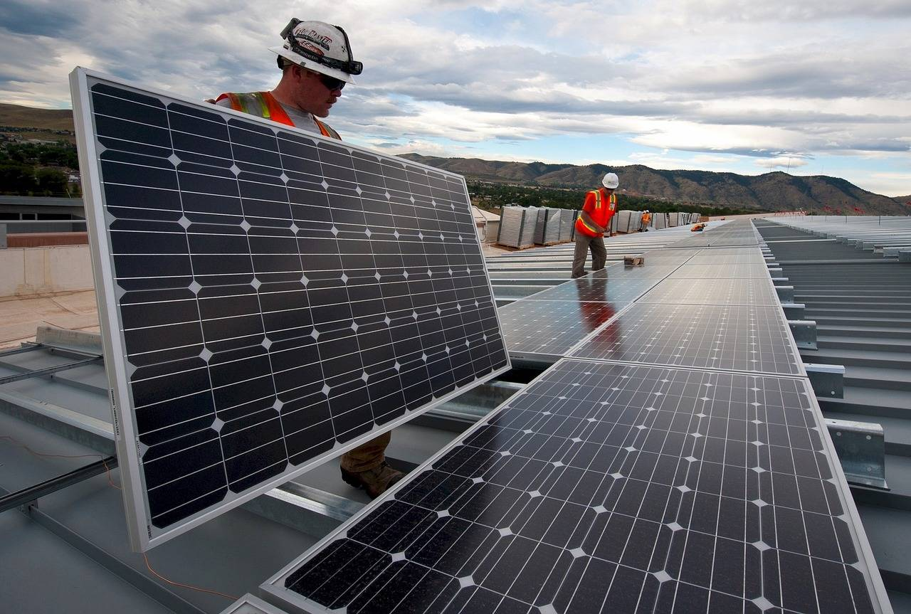

# Wind-Photovoltaic hybrid energy storage power wavelet packet decomposition, fluctuation analysis before and after, capacity configuration, frequency spectrum analysis, grid-connected power fluctuation analysis (Matlab code implementation)

Wind-Photovoltaic hybrid energy storage power wavelet packet decomposition, fluctuation analysis before and after, capacity configuration, spectrum analysis, grid-connected power fluctuation analysis (Matlab code implementation)

## Images

<!-- PAYMENT_BLOCK -->

## Get this dataset

- Payment link (Stripe): [Buy now](https://buy.stripe.com/3cs8yP7sY87d0vu9AB)
- Payment QR code: 

<!-- /PAYMENT_BLOCK -->
